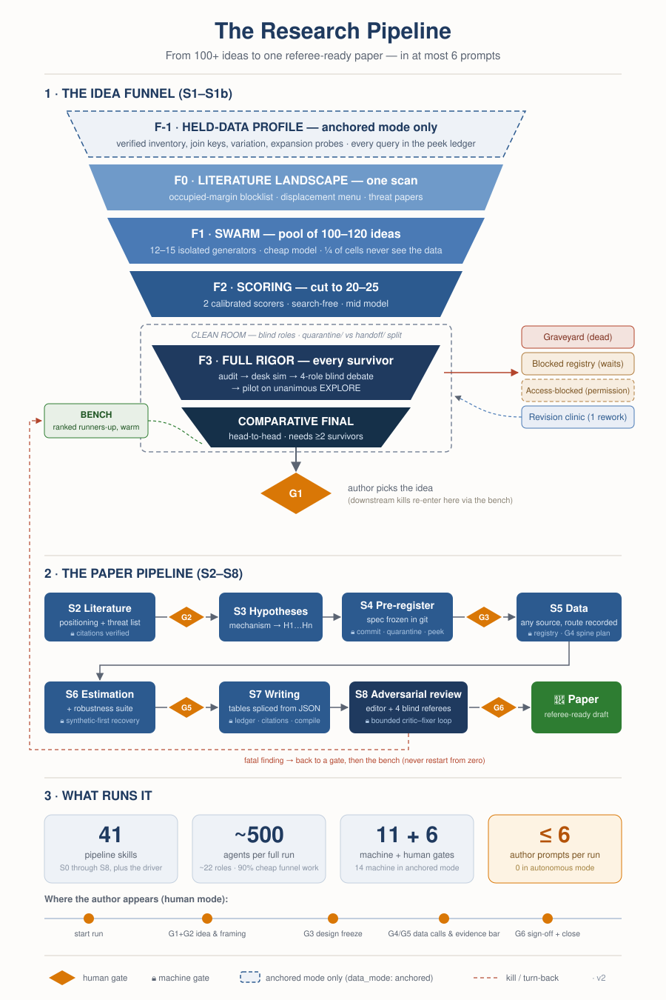

<div align="center">

# Autonomous Research Pipeline

**An end-to-end research workflow for economics, finance and econometrics, run
by an AI agent, with the author deciding at six gates.**

It produces a LaTeX paper that rebuilds from source: every number traced to a
results file, every citation verified against the literature, the specification
frozen in git before the first estimate ran.

[](LICENSE)
[](https://docs.anthropic.com/en/docs/claude-code)
[](https://www.python.org/)
[](gate-fixtures/)

[Why](#why-this-exists) · [Responsible use](#responsible-use) · [How it works](#how-it-works) · [Quick start](#quick-start) · [Does it work](#does-it-work) · [Cost](#what-a-run-costs) · [Not included](#what-is-not-in-here)

</div>

---

## Why this exists

An agent can draft an empirical paper end to end today. That is no longer the
hard part, and treating it as the hard part produces the wrong tool.

The hard part is trust. The ways an AI-run paper fails are specific and they are
all invisible in the output. A number gets retyped from a log into a table and
drifts from the result it came from. A paper gets cited because it sounds right,
and nobody opened it. A specification gets chosen after seeing which one gave
the better coefficient. A null result gets quietly dropped and the surviving
findings get written up as though they were the plan. None of these leave a mark
on the manuscript. Every one of them is fatal in review, and a referee who finds
one stops believing the rest.

So the design question is not how to get an agent to write a paper. It is where
to put checks the agent cannot talk its way past. That is what this is: nine
stages, six places where a human decides, and a set of conditions that refuse to
let a stage pass. The pre-registration is committed before any estimate runs, so
git timestamps the freeze. Numbers reach the manuscript as generated macros, so
no one can type one. A citation that has not been verified field by field is
barred from the draft. An estimand is derived twice by hand and the estimation
package is tested against that reference rather than trusted as the authority.

The gates are the product. The drafting is the easy half.

## Responsible use

**What comes out is a draft you are responsible for, not a submission.** The
pipeline will tell you where it is unsure: a fact it could not verify is marked
`[MATERIAL GAP: ...]` rather than filled in from memory. Read those marks. The
last gate, G6, exists so that a person signs the title, the abstract and the
strength of every claim before the paper leaves the machine. That signature is
the point of the gate.

**Disclose it.** A paper substantially produced this way should say so wherever
it is submitted, and most journals now have a policy on exactly this. Running
with `gate_mode: autonomous`, where pre-specified rules resolve the gates
instead of a person, carries a statement into the paper automatically, because a
reader must never mistake an autonomous paper for a human-gated one.

**It will refuse things.** A machine gate is not advice. If the pre-registration
is not committed, estimation does not run. If a planted effect is not recovered
on synthetic data, real data is not touched. Weakening a check to get past it
defeats the only reason the pipeline is worth running.

## How it works

<p align="center">
  
</p>

Nine stages. Between gates, the agent runs unattended.

| Stage | What happens |
|---|---|
| **S0** | Session bookends. Reads the state file and the lab-notebook tail, produces a five-line brief, and writes the state back at the end so the next session resumes mid-run |
| **S1** | The idea funnel. Profile the data if you hold any, scan the literature, generate 100-plus candidate ideas across isolated generators, then cut to 20-25 by calibrated scoring |
| **S1b** | Debate and pilot. Adversarial multi-round debate, a novelty audit against the literature, and a feasibility pilot that measures whether the sample actually exists |
| **S2** | Literature and positioning. The closest work, what this displaces, and the list of threats a referee will raise |
| **S3** | Hypotheses. Mechanisms become numbered directional predictions, argued from named papers |
| **S4** | Design and pre-registration. The specification, the sample, the decision rule, the null statement, and a power block that refuses a design it cannot detect |
| **S5** | Data construction. Any source, with the route recorded and every script registered |
| **S6** | Estimation and robustness. Synthetic-first, then real data, then the gauntlet: pre-trends, placebos, alternative codings, subsample uniformity |
| **S7** | Writing. Tables spliced from results JSON, prose numbers as generated macros, the paper rebuilt by `make` |
| **S8** | Adversarial review. Simulated referees with sampled dispositions, a hostile-editor pass, and an overclaim audit |

Six gates, where you decide. One decision each, and an approved gate advances
the run without a second confirmation.

| Gate | After | Your decision |
|---|---|---|
| **G1** | S1b | Which idea, from a ranked slate. Or decline all of them and commission a rework |
| **G2** | S2 | Whether the positioning and the threat list are right |
| **G3** | S4 | Sign the pre-registration. This is the freeze |
| **G4** | S5 | Approve the proxies and the data sources actually used |
| **G5** | S6 | Set the bar for what counts as surviving |
| **G6** | S8 | Sign the title, the abstract, and the strength of every claim |

**A human gate and a machine gate are different things.** A human gate is a
judgment call: the pipeline stops, presents the artifacts, and waits for you. A
machine gate is a condition, checked without opinion, and it is not advisory. The
standing rule is that an approval settles a judgment call and never waives a
machine gate. There are 27 machine gates;
[`workflow/pipeline-design.md`](workflow/pipeline-design.md) section 4 lists
every one with what it checks and what happens when it fires.

At G1 the bar is deliberately set at top-journal standard, which means most runs
clear nothing on the first pass. That is the intended behaviour, not a failure.
When no idea clears, the gate reports which card it capped, which check capped
it, and the cheapest change that would clear it, so the rework is directed. It
does not promote the best of a weak slate to fill the menu.

## Requirements

- **Python 3.11 or newer.** Standard library only for the pipeline's own tooling;
  `project-template/requirements.txt` covers the analysis packages.
- **[Claude Code](https://docs.anthropic.com/en/docs/claude-code).** The skills
  are Claude Code skills and are discovered automatically when you open the
  repository. Tested there, and nowhere else: other agent runtimes read the same
  Markdown and may well work, but no one has checked.
- **LaTeX, optional.** Needed to compile the paper to PDF and to render gate
  documents. Everything upstream of S7 runs without it.
- **No API key for literature search.** The bundled backend reads public sources
  (OpenAlex for papers, FRED for macro series) and needs no credentials. A paid
  Corbis key swaps in for better relevance ranking and full text, and is an
  upgrade rather than a requirement. `SETUP.md` covers both.
- **Three model tiers,** set in `pipeline-config.md` as `model_default`,
  `model_mid` and `model_strong`. The funnel does its bulk work on the cheapest
  tier and reserves the strongest for adjudication and review, which is most of
  why a full run is affordable.

## Quick start

```bash
git clone https://github.com/Kylengnq/autonomous-research-pipeline.git
```

```bash
cd autonomous-research-pipeline && python3 gate-fixtures/run_fixtures.py
```

That second command is deliberately before anything else. It runs 109 fixtures
against the bundled skills and should print 109 passing. Do that before you
trust a word of the rest of this file.

```bash
cp -r project-template my-paper && cd my-paper
```

Open `pipeline-config.md` and set `project_name`, `theme` (one sentence saying
what area you want ideas in), `usable_min`, and the three model tiers, which
ship as placeholders. `SETUP.md` section 3 covers the rest, including the
wall-clock budget you want before any unattended run. Every skill reads that
file first, and no skill hardcodes a path. Then hand over control:

```
/run-pipeline
```

It drives S0 through S8 and stops at each gate. A run ends in exactly one of four
states: CHECKPOINT at a gate waiting for you, PARKED where a rule ran out,
ARCHIVED with a documented reject, or DONE.

**The gates are tested.** `gate-fixtures/` holds 109 fixtures across 14
checkers. Each one plants a specific defect a machine gate must catch, or a clean
case it must let through, in both directions, because a check that fires on
everything is as useless as one that never fires. Three fixtures caught real defects on the days they were
written, the most recent of them the one that found `/run-pipeline` could not
enter its own stages, which is the only evidence
that the suite is doing anything. Run it after changing a skill: if a gate lost a
property, a fixture names which.

**The pipeline has been run end to end.** The first full trial passed all 12 of
its scorecard criteria through S0 to S7. A second trial ran 19 scenarios against
the funnel specifically. Both surfaced real problems that changed the design, and
the postmortems are the reason several rules here read oddly: they exist because
the obvious approach failed in a specific way.


## What a run costs

One measured full run came to about $150. The interesting part is where it went:
the driver's own thread was 63% of it, and cost per agent spanned a factor of 56
between a generator on the cheapest model and a batched auditor on the
strongest. That is why the funnel runs about 500 agents and still costs what it
does, and why capping the number of subagents turned out to be the wrong lever.
`tools/run_cost.py` reports a run's actual spend from the session logs. Prices
change; measure your own.

A full run asks for six author prompts or fewer, and zero in autonomous mode.
That number, not the dollar figure, is the one the design optimises.


**Scope.** Built for archival empirical work in economics, finance and
econometrics: panels, event studies, difference-in-differences, instrumental
variables, cross-sectional asset pricing. There is a theory branch and it is
secondary. It is not built for lab experiments, structural estimation, surveys,
or fields outside economics, and the calibration set that anchors idea scoring is
a finance set, so it will mis-score an idea from another field.

**No data.** `project-template/data/` is empty by design.
[`DATA.md`](DATA.md) documents the one dataset that does ship, the calibration
set used for idea scoring, including the construct it substitutes for and the
gaps it carries.

## Known issues

**A first cold run of this repository stopped before G1** and produced the fixes
in it. Four funnel skills carried `disable-model-invocation: true`, which made
them unreachable by `/run-pipeline`, the entry point this README advertises.
That is fixed, and `gate-fixtures/` now carries a reachability check so it
cannot recur silently. The same run found that the skills and the submission
hooks could not both load in one session, because they resolved from different
directories and the failure was silent; the hooks now live at the repository
root and find the paper project underneath, with five fixtures covering the
cases. The run reached S0 and stopped at S1, so a full funnel run to G1 has
still not been completed against this published tree.

## Layout

| Path | What it is |
|---|---|
| `.claude/skills/` | The 41 skills, the playbooks, and the config template. Discovered automatically by Claude Code |
| `workflow/` | The stage map. `pipeline-design.md` is canonical, `pipeline-guide.md` is the readable tour |
| `references/` | Shared inputs the skills read: the calibration set, writing norms, journal standards |
| `tools/` | Cost accounting, gate-document rendering, and the literature search backend |
| `gate-fixtures/` | The 109 planted-failure fixtures |
| `project-template/` | Copy this per paper |
| `docs/` | The per-skill writing spec, for extending the pipeline |

## License and citation

MIT, see [`LICENSE`](LICENSE). [`NOTICE.md`](NOTICE.md) credits the prior work
this was written against and states what it does not redistribute.
[`DATA.md`](DATA.md) carries the calibration set's provenance.

```bibtex
@software{nguyen_autonomous_research_pipeline,
  author  = {Nguyen, Trung},
  title   = {Autonomous Research Pipeline: an agent-run research workflow
             for economics, finance and econometrics},
  year    = {2026},
  url     = {https://github.com/Kylengnq/autonomous-research-pipeline},
  license = {MIT}
}
```

A predecessor focused on one venue's documentation requirements rather than on
the research pipeline is at
[Kylengnq/afa-ai-workflow](https://github.com/Kylengnq/afa-ai-workflow).
